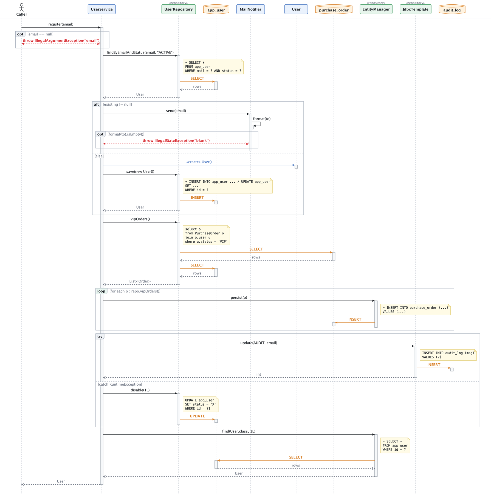
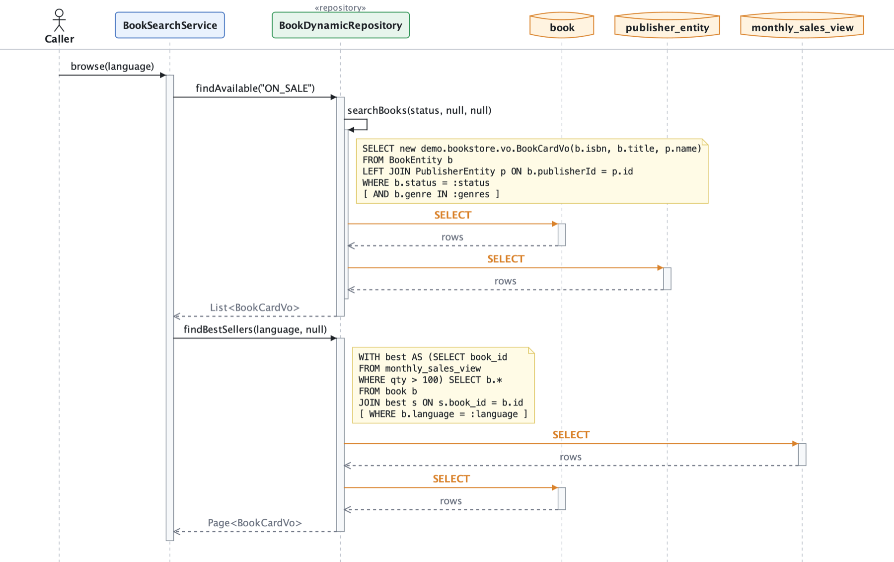
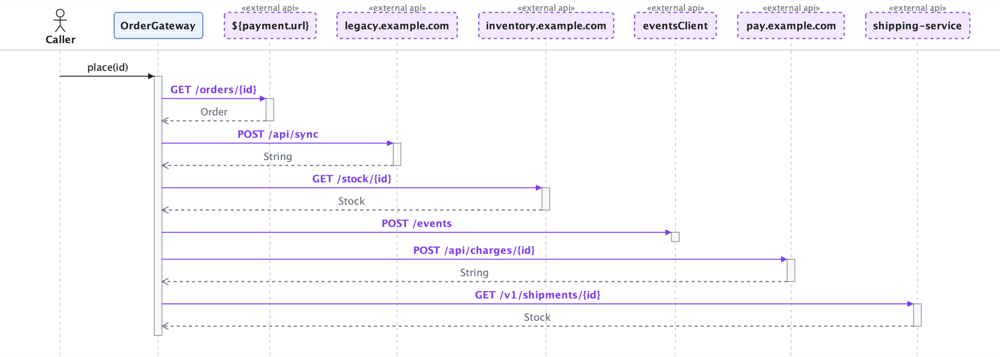
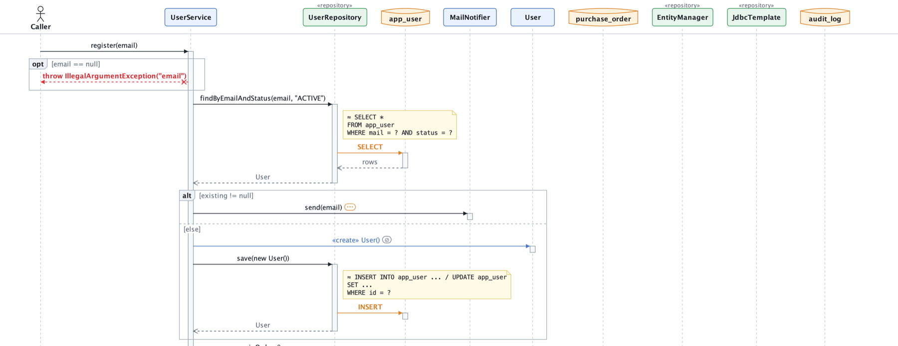

<div align="center">
    <a href="https://plugins.jetbrains.com/plugin/35963-seqlens">
        
    </a>
</div>

<h1 align="center">SeqLens</h1>

<p align="center">Turn Java code into interactive sequence diagrams — with the database tables and external APIs it touches.</p>

<p align="center">
<a href="https://plugins.jetbrains.com/plugin/35963-seqlens"></a>
<a href="https://plugins.jetbrains.com/plugin/35963-seqlens"></a>
<a href="https://plugins.jetbrains.com/plugin/35963-seqlens"></a>
</p>

<br>

> Jetbrains Marketplace: https://plugins.jetbrains.com/plugin/35963-seqlens

<br>

<b>SeqLens</b> statically analyzes a Java method and draws the call flow as a sequence diagram right inside IntelliJ IDEA.
Every arrow, participant and SQL note is clickable and jumps to the source, and data access and outgoing HTTP calls
are drawn against the tables and services they reach, so you can see what a request really does before reading every line.

## Features

### Sequence Diagrams from Java Methods
Right-click inside any Java method and choose **SeqLens: Generate Sequence Diagram**. Calls are followed down to the configured depth.

- **Control flow fragments**: `if / else` → `alt` / `opt`, loops and stream lambdas (`forEach`, `map`, …) → `loop`, `try / catch` → `try`, `switch` → `alt`.
- **Polymorphism aware**: when an interface has exactly one production implementation (test fakes are ignored, `@Primary` breaks ties), that implementation is expanded.
- **`throw`**: drawn as a red dashed arrow back to the caller, labeled with the exception type.
- **Click to navigate**: arrows jump to the call site, participants to the class, tables to the `@Entity`, notes to the `@Query` / SQL string.



### Database Tables from JPA and SQL
Data access is drawn as `SELECT` / `INSERT` / `UPDATE` / `DELETE` arrows to database tables, with the SQL shown as a note.

- **Spring Data repositories**: derived queries (`findByEmailAndStatus` → `WHERE mail = ? AND status = ?`, honoring `@Column`), built-in CRUD, `@Query` (JPQL and native) and `@NamedQuery`.
- **JPQL**: entity names are mapped to table names (`@Table` → `@Entity(name)` → snake_case), including joins such as `JOIN o.customer c` and `LEFT JOIN PublisherEntity p ON …`.
- **`@DynamicRepository` / `@DynamicQuery`**: JPQL or native SQL with `[ … ]` optional fragments; tables inside fragments are listed too.
- **`EntityManager`, Hibernate `Session`, `JdbcTemplate`, `NamedParameterJdbcTemplate`, `JdbcClient`**: SQL is recovered from literals, constants, local variables and string concatenation.



### External APIs from HTTP Clients
Outgoing HTTP calls are drawn to an «external api» participant, with arrows labeled like `GET /orders/{id}` and the response type on the return arrow.

- `RestTemplate`, `RestClient` and `WebClient` call chains (including `baseUrl(...)` and `uri(b -> b.path(...))`)
- Declarative `@HttpExchange` / `@GetExchange` / `@PostExchange` … interfaces
- OpenFeign `@FeignClient`
- The service name comes from the URL host, a `@Value("${...}")` placeholder or the Feign client name.



### Focus on What Matters
- **Stop list**: classes or methods that should be drawn but not expanded (marked `⊘`), e.g. `com.foo.AuditService`, `*Client`, `LogUtil#*`. Right-click a message → **Don't Expand…** to add it.
- **Maximum depth warning**: calls not expanded because of the depth limit are marked `⋯`, and a banner offers **Regenerate 2 levels deeper**.
- **MapStruct**: `@Mapper` calls are drawn as a single call (marked «mapper», tooltip shows `User → UserDto`) without expanding the generated `XxxMapperImpl`.
- **Noise reduction**: real getters / setters, excluded packages and library calls are skipped.



### Resources Panel
Toggle **Resources** in the toolbar to list everything the flow uses — external APIs (service → endpoint → call site), tables (table → operation → repository method) and classes / methods — each section can be shown or hidden, and every entry jumps to the code.

### Copy and Export
- **Copy…**: image (PNG, ready to paste into chats and documents), SVG, PlantUML, Mermaid, resources (Markdown)
- **Export…**: SVG (vector), PNG (3x resolution), PlantUML (`.puml`), Mermaid (`.mmd`), resources (`.md`)

## Getting Started
1. Install the plugin: **Settings | Plugins | ⚙ | Install Plugin from Disk…** and choose `build/distributions/intellij-seq-lens-<version>.zip`.
2. Place the caret inside a Java method, right-click and choose **SeqLens: Generate Sequence Diagram** (also available from the Project view, the Structure view and the **Tools** menu).
3. Click arrows, participants and notes to jump to the code; zoom with **Ctrl/⌘ + mouse wheel**.
4. Tune the analysis in **Settings | Tools | SeqLens**: tool window position, font size, maximum depth, stop list, exclusions, and JPA / HTTP / MapStruct detection. Hover the **?** next to an option for details.

## Building from Source
Requires JDK 21 (selected automatically through the Gradle toolchain).

```bash
./gradlew runIde       # start a sandbox IntelliJ IDEA with the plugin installed
./gradlew test         # unit tests and PSI-based integration tests
./gradlew buildPlugin  # build/distributions/intellij-seq-lens-<version>.zip
```

## Limitations
- The analysis is static: runtime types cannot be known, so an interface with several implementations stops at the interface.
- Dynamically built SQL and URLs (`StringBuilder`, conditional concatenation) are only partially recovered; unknown parts are shown as `?`.
- SQL starting with `≈` is derived from the method name for illustration and is not the exact statement executed.
- Criteria API, Querydsl and MyBatis XML mappers are not supported yet.
